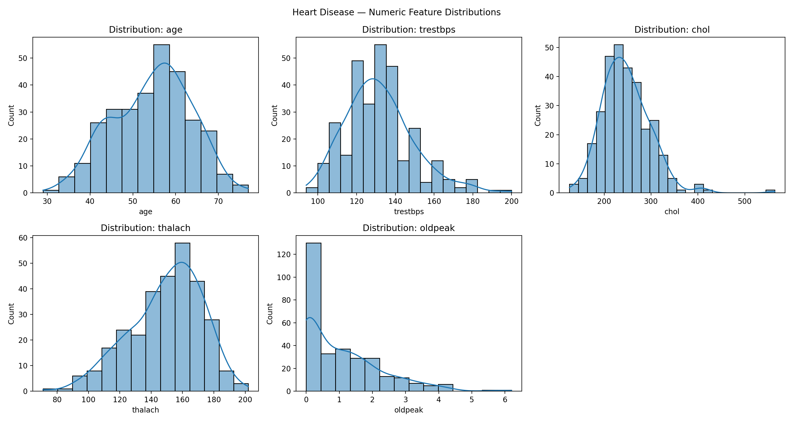
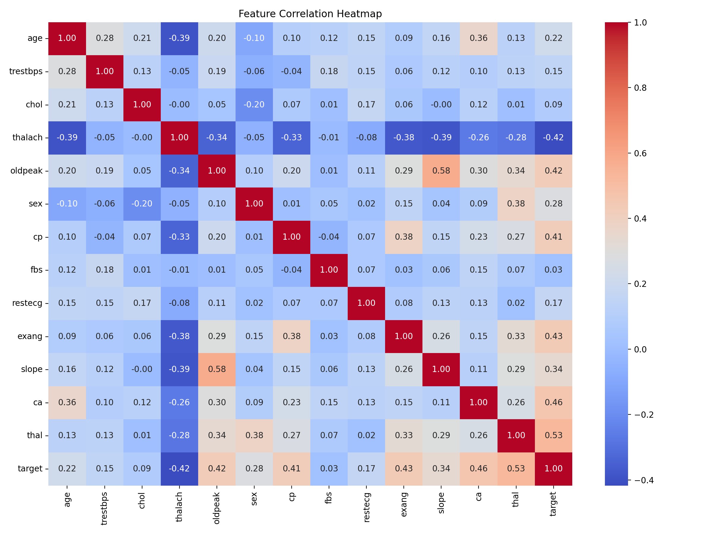
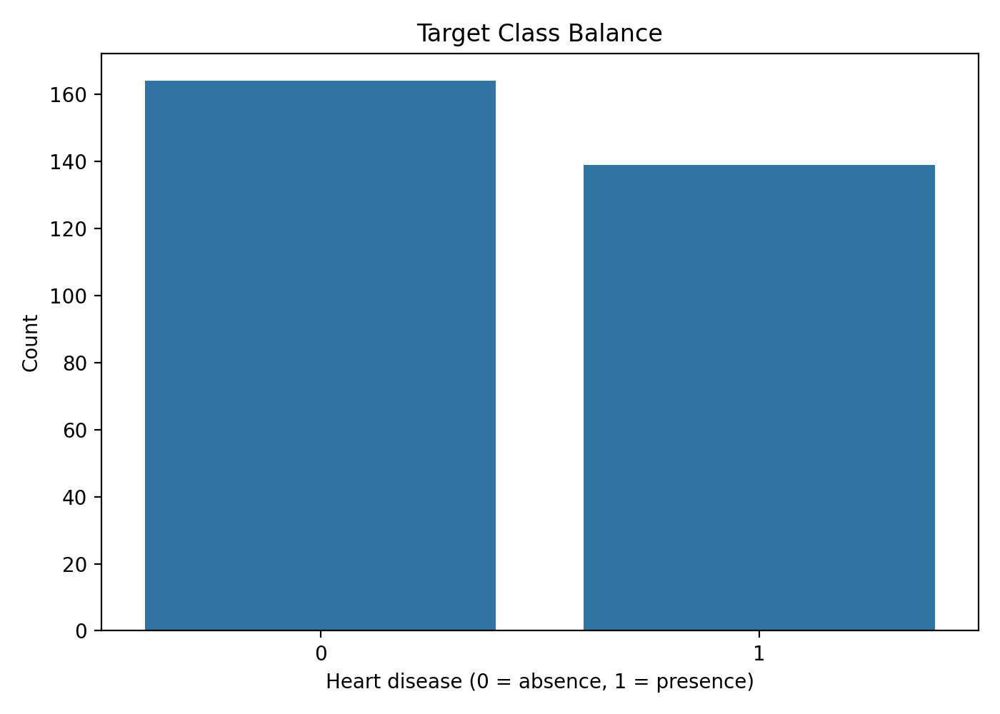
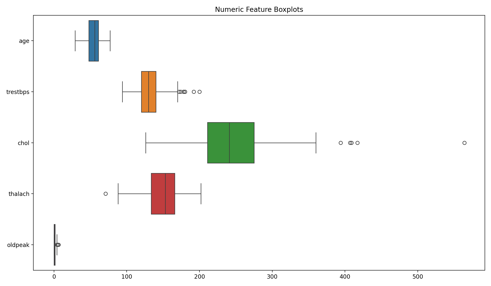
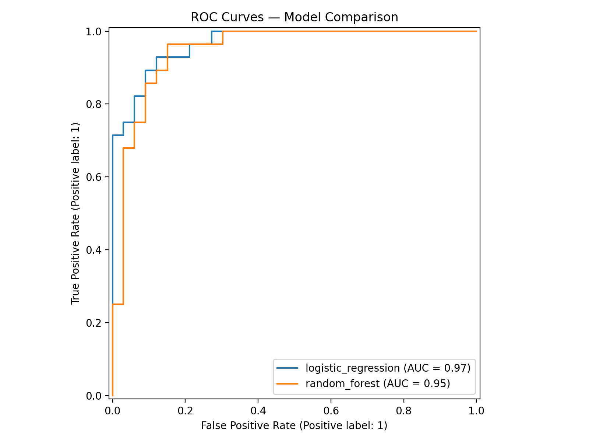
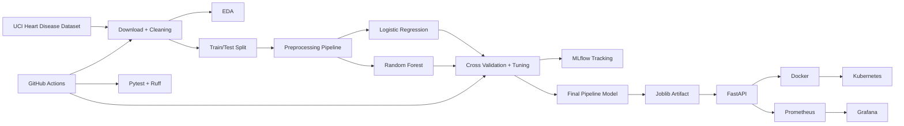
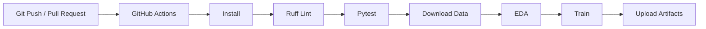
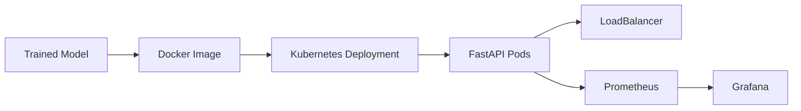

# MLOps Assignment 01 — End-to-End Heart Disease ML System

**Student:** [YOUR NAME]  
**Course:** AIMLCZG523 — Machine Learning Operations  
**Assignment:** 01  
**Total Marks:** 50  
**GitHub Repository:** [INSERT LINK]  
**API URL:** [INSERT URL OR LOCAL ACCESS INSTRUCTIONS]

---

## 1. Executive Summary

This project implements an end-to-end MLOps pipeline for binary heart-disease classification using the UCI Heart Disease dataset.

The workflow covers data acquisition, cleaning, exploratory data analysis, feature preprocessing, model comparison, hyperparameter tuning, cross-validation, experiment tracking with MLflow, reproducible model packaging, automated testing, GitHub Actions CI/CD, Docker containerization, Kubernetes deployment, API monitoring, and technical documentation.

**Personalize this section with your actual final model, metrics, deployment environment, and observations.**

---

## 2. Problem Statement and Objectives

The objective is to build a classifier that predicts the presence/absence of heart disease from patient health attributes and deploy it as a cloud-ready monitored API.

The implementation addresses:

- Data acquisition and cleaning
- EDA
- Encoding and scaling
- Two classification algorithms
- Cross-validation and tuning
- Accuracy, precision, recall, ROC-AUC
- MLflow experiment tracking
- Reproducible preprocessing + model packaging
- Unit testing
- CI/CD
- Docker
- Kubernetes
- Prometheus/Grafana monitoring

---

## 3. Dataset

**Source:** UCI Machine Learning Repository — Heart Disease dataset.

Document:

- dataset size;
- input variables;
- target definition;
- missing-value handling;
- source citation;
- license;
- download procedure.

**Insert screenshot:** `screenshots/01_dataset.png`

---

## 4. Data Acquisition and Cleaning

Explain `download_data.py`.

Explain:

1. UCI dataset retrieval;
2. feature naming;
3. target conversion;
4. missing-value normalization;
5. target-row handling;
6. why feature imputation is performed inside the ML pipeline.

**Insert screenshot:** `screenshots/02_cleaning.png`

---

## 5. Exploratory Data Analysis

### 5.1 Histograms



Discuss important distributions.

### 5.2 Correlation Heatmap



Discuss notable correlations without claiming causation.

### 5.3 Class Balance



Explain whether the classes are balanced and how stratification/class weighting were considered.

### 5.4 Outliers



Describe observed outliers and the treatment used.

---

## 6. Feature Engineering and Preprocessing

The final preprocessing uses:

- median imputation + standard scaling for numerical variables;
- most-frequent imputation + one-hot encoding for categorical variables.

Explain why fitting transformations only on training folds avoids data leakage.

---

## 7. Model Development

### Model 1 — Logistic Regression

Describe:

- algorithm;
- strengths;
- hyperparameters;
- GridSearchCV;
- CV metric.

### Model 2 — Random Forest

Describe:

- ensemble/tree approach;
- hyperparameters;
- GridSearchCV;
- CV metric.

### Model comparison

Paste the generated `artifacts/metrics/model_comparison.csv` results here.

| Model | CV ROC-AUC | Test Accuracy | Test Precision | Test Recall | Test ROC-AUC |
|---|---:|---:|---:|---:|---:|
| Logistic Regression | [ ] | [ ] | [ ] | [ ] | [ ] |
| Random Forest | [ ] | [ ] | [ ] | [ ] | [ ] |

Do not invent values. Use the values generated by your run.



---

## 8. MLflow Experiment Tracking

Show:

- experiment name;
- runs;
- parameters;
- CV scores;
- test metrics;
- CV result artifacts;
- classification reports;
- ROC plot;
- saved model artifacts.

**Insert screenshots:**

- `screenshots/03_mlflow_runs.png`
- `screenshots/04_mlflow_metrics.png`
- `screenshots/05_mlflow_artifacts.png`

---

## 9. Reproducibility and Model Packaging

Explain that `artifacts/model.joblib` contains the complete sklearn pipeline, including preprocessing and classifier.

Explain:

- fixed random seed;
- requirements file;
- deterministic preprocessing;
- model artifact;
- train/test split;
- CV strategy.

---

## 10. Testing and CI/CD

Unit tests cover:

- data cleaning;
- target conversion;
- missing target handling;
- preprocessing fit/transform;
- API health;
- API prediction response.

GitHub Actions executes:

1. dependency installation;
2. linting;
3. unit tests;
4. dataset download;
5. EDA;
6. training;
7. artifact upload.

**Insert screenshots:**

- `screenshots/06_pytest.png`
- `screenshots/07_github_actions.png`

---

## 11. Containerization

Explain the Dockerfile and why the model artifact is copied into the image.

Commands used:

```bash
docker build -t heart-disease-mlops:latest .
docker run --rm -p 8000:8000 heart-disease-mlops:latest
```

**Insert screenshots:**

- `screenshots/08_docker_build.png`
- `screenshots/09_health_endpoint.png`
- `screenshots/10_predict_endpoint.png`

---

## 12. API Design

### `/health`

Returns service and model-load status.

### `/predict`

Accepts JSON input containing 13 features and returns:

- binary prediction;
- confidence;
- probability of absence;
- probability of presence.

### `/metrics`

Exposes Prometheus-compatible application metrics.

Include a sample request/response from your actual deployment.

---

## 13. Production Deployment

Deployment target: **[Minikube / GKE / EKS / AKS / other]**

Explain:

- Deployment;
- replicas;
- readiness probe;
- liveness probe;
- resource requests/limits;
- LoadBalancer service.

**Insert screenshots:**

- `screenshots/11_kubernetes_pods.png`
- `screenshots/12_kubernetes_service.png`
- `screenshots/13_deployed_api.png`

---

## 14. Monitoring and Logging

The API logs:

- HTTP method;
- path;
- response status;
- request duration.

Prometheus scrapes `/metrics`.

Grafana displays:

- request rate;
- p95 latency;
- total requests.

**Insert screenshot:** `screenshots/14_grafana.png`

Discuss how these metrics can be used to identify traffic spikes, latency changes, or service failures.

---

## 15. Architecture



---

## 16. CI/CD Workflow



---

## 17. Deployment Workflow



---

## 18. Production Readiness

Demonstrate:

- clean setup from `requirements.txt`;
- successful tests;
- successful model training;
- Docker build;
- isolated API execution;
- Kubernetes health probes;
- logs;
- metrics;
- monitoring dashboard.

---

## 19. Limitations and Future Improvements

Possible discussion points:

- small dataset size;
- clinical variables are not sufficient for medical diagnosis;
- deployment is an educational MLOps demonstration;
- production systems require stronger security, authentication, secret management, model governance, drift detection, data validation, and clinical validation.

---

## 20. Conclusion

Write your own conclusion based on the actual run. Mention the final model, measured metrics, MLflow evidence, CI/CD result, container deployment, Kubernetes verification, and monitoring evidence.

---

## Appendix A — Commands

```bash
python -m venv .venv
source .venv/bin/activate
pip install -r requirements.txt
pip install -r requirements-dev.txt

python download_data.py
python -m src.eda
python -m src.train
pytest -q
ruff check .

uvicorn src.api:app --host 0.0.0.0 --port 8000

docker build -t heart-disease-mlops:latest .
docker run --rm -p 8000:8000 heart-disease-mlops:latest

minikube start
minikube image load heart-disease-mlops:latest
kubectl apply -f k8s/
minikube tunnel
```

## Appendix B — Assignment Coverage

| Requirement | Implementation |
|---|---|
| Data acquisition | `download_data.py` |
| Cleaning | `src/data.py` |
| Histograms | `src/eda.py` |
| Correlation heatmap | `src/eda.py` |
| Class balance | `src/eda.py` |
| Scaling | `src/train.py` |
| Encoding | `src/train.py` |
| 2 classification models | Logistic Regression + Random Forest |
| Tuning | GridSearchCV |
| Cross-validation | StratifiedKFold |
| Accuracy | Yes |
| Precision | Yes |
| Recall | Yes |
| ROC-AUC | Yes |
| MLflow | Yes |
| Params | Yes |
| Metrics | Yes |
| Artifacts/plots | Yes |
| Reusable model | `artifacts/model.joblib` |
| Requirements | `requirements.txt` |
| Reproducible preprocessing | sklearn Pipeline |
| Unit tests | `tests/` |
| CI/CD | `.github/workflows/ci.yml` |
| Linting | Ruff |
| Automated training | GitHub Actions |
| Docker | `Dockerfile` |
| API | FastAPI `/predict` |
| Confidence | Yes |
| Kubernetes | `k8s/` |
| LoadBalancer | `api-service.yaml` |
| Monitoring | Prometheus |
| Dashboard | Grafana |
| Logging | FastAPI middleware |
| Report | `report.md` |
| Screenshots | `screenshots/` |
| Video | Record your own pipeline walkthrough |
